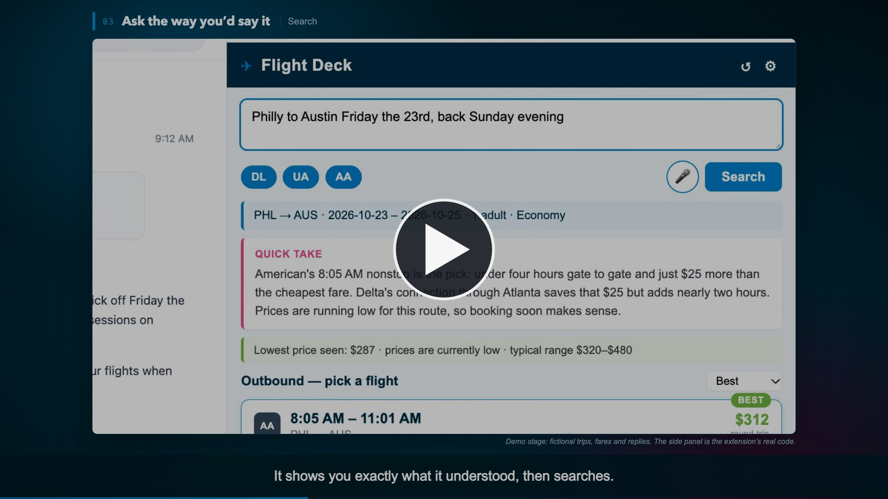

# Flight Deck

**[▶ Watch the 2-minute explainer](https://github.com/ericediger/flight-deck/blob/main/media/flight-deck-explainer.mp4)**

A Chrome side-panel extension for quick natural-language and **voice** flight lookups on **Delta, United, and American**. Type or speak a request — Claude parses it, SerpApi's Google Flights engine returns real fares, and a short conversational recommendation (spoken aloud if you like) sits on top.

Ask two kinds of questions:

- **Booking** — "SLC to Austin next Friday, back Sunday evening": pick an outbound, pick a return, and your selections pin to a trip summary. **Book This Trip** opens the same search on Google Flights.
- **Exploring** — "Are there daily nonstop flights from Philadelphia to Athens?": samples a few representative days and answers conversationally, with the sampled days behind a toggle.

If details are missing it asks one question and keeps the conversation context (typed or spoken). The ↺ button starts fresh.

## Install (unpacked extension)

1. Open `chrome://extensions`, enable **Developer mode**
2. **Load unpacked** → select this folder
3. Open the side panel from the toolbar icon, click the gear (⚙), add keys:
   - **Anthropic API key** (parsing + recommendations)
   - **SerpApi key** (flight data; free plan is 250 searches/month)
   - **OpenAI API key** *(optional — enables the mic and spoken results)*

Keys stay in `chrome.storage.local` and are sent only to the three APIs above. First mic use opens a one-time permission tab (side panels can't show the mic prompt).

## Development

`dev/dev.html` runs the real UI against stubbed storage/mic and mocked API responses — serve the folder (`python3 -m http.server`) and open `/dev/dev.html`.
